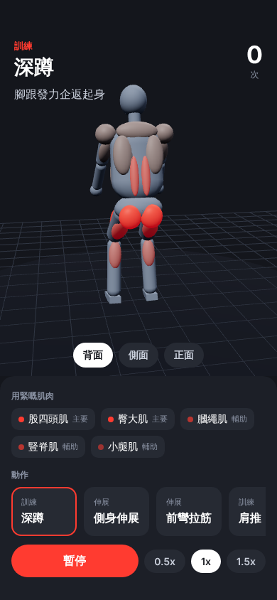

# Train Buddy 🏋️

一個 3D 健身陪練 App 原型：人形會示範伸展同訓練動作，你可以由背面睇佢做，練緊嘅肌肉會發紅光。



## 開始

```bash
npm install
npx expo start
```

- 手機裝 **Expo Go**，掃 QR code 就可以試
- 撳 `w` 用瀏覽器開

## 項目結構

```
App.tsx                         主畫面（動作選擇、肌肉清單、控制）
src/components/TrainerScene.tsx 3D 場景、鏡頭、動畫播放
src/components/HumanFigure.tsx  載入 3D 人形模型、肌肉發光（跟骨頭郁）
src/data/exercises.ts           動作總表（基本動作 + 動作庫）
src/data/types.ts               動作類型、分類（基本 / P0–P3）
src/data/library/ch4.ts         身體操作書 ch4 初級動作庫（16 個）
src/data/library/ch5.ts         身體操作書 ch5 發展動作庫（13 個）
src/data/muscles.ts             肌肉名稱
src/lib/pose.ts                 姿勢類型同插值（尺寸由模型量出嚟）
src/lib/retarget.ts             轉換層：app 關節角度 -> Mixamo 骨頭旋轉
assets/models/figure.glb        人形模型（Tripo 生成、綁 Mixamo 骨、Blender 整理）
tools/                          模型流程腳本（Tripo API、Blender 整理同量度）
docs/PLAN.md                    開發規劃
```

## 人形模型流程

1. 參考圖 `assets/reference/mannequin-front.png`（A-pose 灰色公仔）
2. `tools/tripo_generate.py`：Tripo API 生成模型 + 自動綁 Mixamo 骨
   （key 用環境變數 `TRIPO_API_KEY`；或者 `blender --background --python tools/tripo_blender_run.py` 由 Blender 插件設定讀）
3. `blender --background --python tools/clean_figure.py`：轉方向、縮到 1.75 m、腳踩 y=0
4. `blender --background --python tools/measure_figure.py`：量關節位置，更新 `src/lib/pose.ts` 尺寸

換模型之後，肌肉位置喺 `HumanFigure.tsx` 嘅 `CENTER` / `LEFT` 表微調。

詳細規劃睇 [docs/PLAN.md](docs/PLAN.md)。
